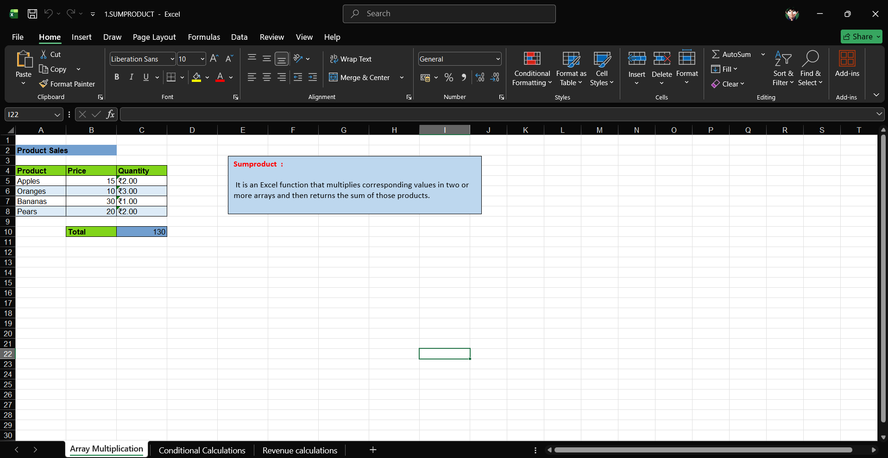
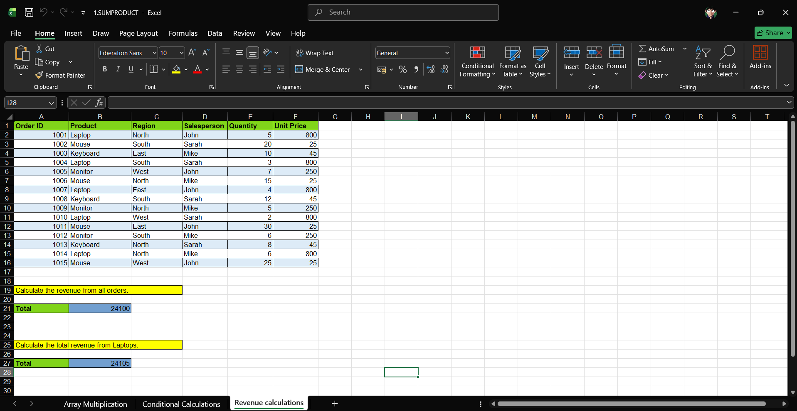
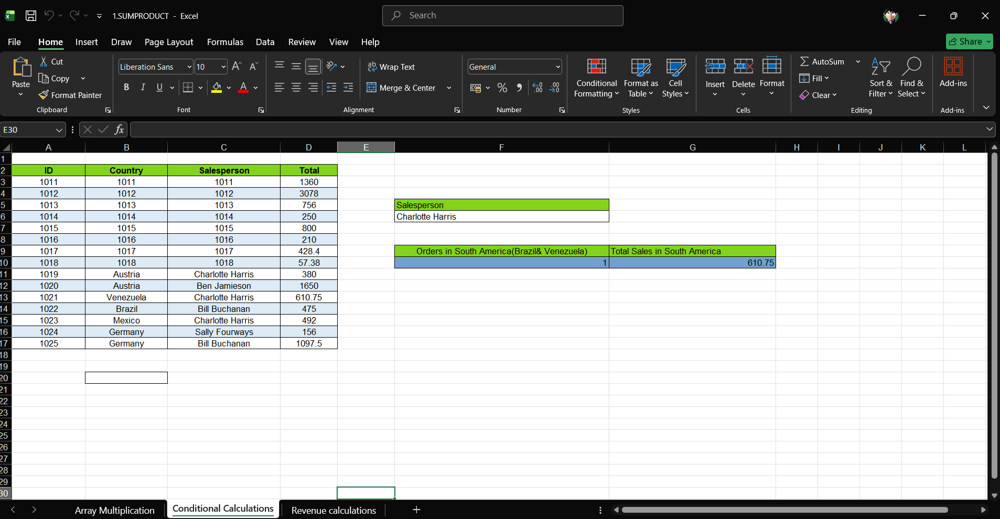
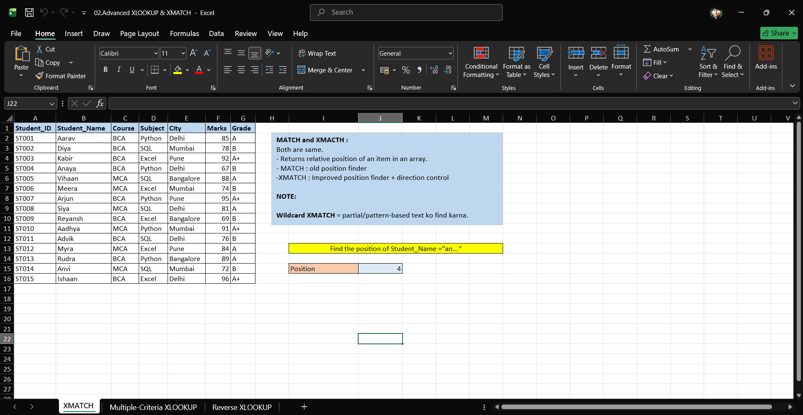
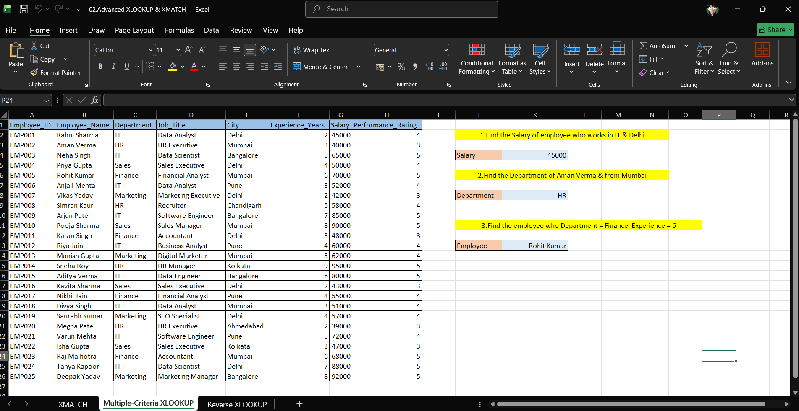
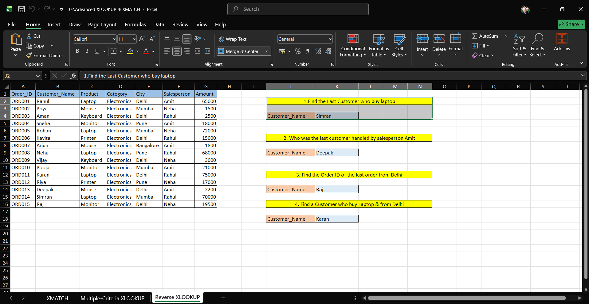

# Stuff I Learn About Advanced Excel for Reference

This repository contains my **personal notes and practice files on Excel**.
Each section includes the **Excel file name and a screenshot of the output for quick reference**.

# 01. SUMPRODUCT

**File:** `01.SUMPRODUCT.xlsx`

### Concepts Covered

- SUMPRODUCT Function
- Array Multiplication
- Multiplying corresponding values
- Calculating total sales
- Calculating total revenue
- Conditional Calculations
- Applying multiple conditions
- Sales data analysis
- Revenue calculations
- Performing calculations without helper columns


## Array Multiplication

This exercise demonstrates how the **SUMPRODUCT function** can be used to multiply corresponding values in two arrays and return the sum of the resulting products.

### Dataset

The dataset includes:

- Product
- Price
- Quantity

### Calculation

The exercise calculates the total product sales by multiplying the corresponding **Price** and **Quantity** values.

### Screenshot




## Revenue Calculations

This exercise demonstrates how **SUMPRODUCT** can be used to calculate revenue from sales data.

### Dataset

The dataset includes:

- Order ID
- Product
- Region
- Salesperson
- Quantity
- Unit Price

### Calculations

The exercise calculates:

- Revenue from all orders
- Revenue for specific products
- Revenue using Quantity and Unit Price

### Screenshot




## Conditional Calculations

This exercise demonstrates how **SUMPRODUCT** can be combined with conditions to perform conditional calculations.

### Dataset

The dataset includes:

- ID
- Country
- Salesperson
- Total

### Conditions Covered

- Checking salesperson conditions
- Checking country conditions
- Applying multiple conditions
- Counting orders based on conditions
- Calculating total sales based on conditions

### Screenshot




## Data Analysis

The exercise uses **SUMPRODUCT** for array multiplication, revenue calculations, and conditional calculations.

The analysis includes:

- Calculating total product sales
- Calculating total revenue
- Calculating product-specific revenue
- Analyzing sales by salesperson
- Analyzing sales by country
- Applying multiple conditions
- Performing conditional calculations

# 02. Advanced XLOOKUP & XMATCH

**File:** `02.Advanced XLOOKUP & XMATCH.xlsx`

### Concepts Covered

- XMATCH Function
- XLOOKUP Function
- Multiple-Criteria XLOOKUP
- Reverse XLOOKUP
- Exact Match
- Wildcard Match
- Multiple Conditions
- Searching from Last to First
- Dynamic Lookup
- Advanced Data Retrieval

---

## XMATCH Function

The **XMATCH function** is used to find the relative position of a value within a range or array.

### Dataset

The dataset contains student information:

- Student_ID
- Student_Name
- Course
- Subject
- City
- Marks
- Grade

### Exercises

- Find the position of a student name using a wildcard.
- Find the position of a value within a range.
- Use wildcard matching for partial text.

### Concepts Covered

- Exact Match
- Wildcard Match
- Finding the position of a value
- Using `*` wildcard
- Dynamic position lookup

### Screenshot



---

## Multiple-Criteria XLOOKUP

**XLOOKUP** can be combined with multiple conditions to retrieve a value when more than one criterion must be satisfied.

### Dataset

The dataset contains employee information:

- Employee_ID
- Employee_Name
- Department
- Job_Title
- City
- Experience_Years
- Salary
- Performance_Rating

### Exercises

- Find the **Salary** of an employee who works in **IT** and **Delhi**.
- Find the **Department** of an employee based on **Employee Name** and **City**.
- Find the **Employee** where **Department = Finance** and **Experience = 6**.

### Concepts Covered

- Multiple-Criteria XLOOKUP
- Combining multiple conditions
- Concatenating lookup criteria
- Retrieving data using multiple conditions
- Advanced employee data lookup

### Screenshot



---

## Reverse XLOOKUP

**Reverse XLOOKUP** is used to search from the **last occurrence to the first occurrence**.

This is useful when you need to find the **latest or last matching record**.

### Dataset

The dataset contains order information:

- Order_ID
- Customer_Name
- Product
- Category
- City
- Salesperson
- Amount

### Exercises

- Find the **last customer who bought a Laptop**.
- Find the **last customer handled by salesperson Amit**.
- Find the **Order ID of the last order from Delhi**.
- Find a customer who bought a **Laptop from Delhi**.

### Concepts Covered

- Reverse XLOOKUP
- Last occurrence lookup
- Searching from bottom to top
- Finding the latest matching record
- XLOOKUP Search Mode
- Dynamic lookup

### Screenshot



---

# XLOOKUP & XMATCH Summary

| Function / Technique | Purpose |
|---|---|
| **XMATCH** | Finds the position of a value in a range |
| **XMATCH Wildcard** | Finds a position using wildcard matching |
| **XLOOKUP** | Searches for a value and returns a related result |
| **Multiple-Criteria XLOOKUP** | Performs lookups using multiple conditions |
| **Reverse XLOOKUP** | Finds the last matching occurrence |
| **Wildcard `*`** | Matches any number of characters |
| **Search Mode `-1`** | Searches from last to first |

---

# Data Analysis

These exercises demonstrate how **XLOOKUP and XMATCH** can be used for advanced Excel data analysis.

The practice includes:

- Finding the position of values
- Using wildcard matching
- Performing multiple-condition lookups
- Finding employee salary
- Finding employee department
- Finding employees based on multiple conditions
- Finding the last matching customer
- Finding the last order from a specific city
- Searching from bottom to top
- Performing advanced lookups without helper columns

## Key Learning

**XLOOKUP** and **XMATCH** are powerful modern Excel functions for performing flexible and dynamic lookups.

By combining these functions with **multiple criteria, wildcard matching, and reverse searching**, complex lookup requirements can be handled efficiently in Excel.

# 03. Dynamic Array Functions

**File:** `03.Dynamic Array Functions.xlsx`

## Concepts Covered

* Dynamic Array Functions
* FILTER Function
* SORT Function
* SORTBY Function
* UNIQUE Function
* SEQUENCE Function
* Combining Dynamic Array Functions
* Filtering data based on conditions
* Sorting data dynamically
* Extracting unique values
* Generating sequential numbers
* Creating dynamic reports
* Working with spilled arrays
* Performing calculations without helper columns

---

# Dataset

The exercises use a **One Piece Characters dataset** containing information about different characters.

### Dataset Columns

* Character
* Gender
* Affiliation
* Role
* Bounty_M
* Age
* Devil_Fruit
* Haki
* Origin
* Status
* Rank
* Height_cm
* First_Appearance

The dataset is used throughout the exercises to demonstrate how Dynamic Array Functions can automatically return multiple results.

### Dataset Screenshot


---

# FILTER Function

The **FILTER function** is used to return only the rows or columns that meet a specified condition.

### Exercise

Find the crew members of the **Straw Hat Pirates** from the dataset.

### Concepts Covered

* Filtering rows based on a condition
* Using a text condition
* Returning multiple matching records
* Dynamic spilling of results
* Filtering an entire dataset

### Example

The FILTER function is used to return characters whose **Affiliation** is:

`Straw Hat Pirates`

### Screenshot


---

# SORT Function

The **SORT function** is used to dynamically sort a dataset based on a selected column.

### Exercise

Sort the dataset based on **Bounty**, from:

**Highest → Lowest**

### Concepts Covered

* Sorting data dynamically
* Sorting based on a specific column
* Descending order
* Returning the complete sorted dataset
* Dynamic array sorting

### Example

The dataset is sorted using the **Bounty_M** column in descending order.

### Screenshot


---

# SORTBY Function

The **SORTBY function** is used to sort one array based on the values in another array.

### Exercise

Sort the dataset based on **Age**, from:

**Highest → Lowest**

### Concepts Covered

* Sorting using another range
* Sorting by Age
* Descending order
* Dynamic sorting
* Sorting an entire dataset based on a selected column

### Example

The dataset is dynamically sorted using the **Age** column.

### Screenshot


---

# UNIQUE Function

The **UNIQUE function** is used to extract distinct values from a dataset.

### Exercise

Find all unique **Affiliations** from the dataset.

### Concepts Covered

* Extracting unique values
* Removing duplicate values
* Creating dynamic lists
* Working with text data
* Dynamic spilling of unique results

### Example

The UNIQUE function is used to create a list of all unique affiliations such as:

* Marines
* Whitebeard Pirates
* Straw Hat Pirates
* Revolutionary Army
* Big Mom Pirates
* and other affiliations

### Screenshot


---

# SEQUENCE Function

The **SEQUENCE function** is used to generate a sequence of numbers automatically.

### Exercise

Generate a sequential number for each character in the dataset.

### Concepts Covered

* Generating sequential numbers
* Automatic numbering
* Dynamic arrays
* Creating serial numbers
* Using SEQUENCE with other data

### Example

The SEQUENCE function generates numbers such as:

`1, 2, 3, 4, 5, ...`

for the characters in the dataset.

### Screenshot


---

# Combining Dynamic Array Functions

Dynamic Array Functions can be combined to perform more advanced data analysis.

### Exercise

Find **Straw Hat Pirates** and sort them based on their **Bounty**.

### Concepts Covered

* Combining FILTER and SORT
* Filtering data first
* Sorting filtered results
* Creating dynamic reports
* Working with multiple dynamic arrays
* Performing analysis without helper columns

### Example

The exercise first filters the dataset to find members of the:

`Straw Hat Pirates`

The filtered results are then sorted based on **Bounty**.

### Screenshot


---

# Dynamic Array Functions Summary

| Function | Purpose |
|----------|---------|
| **FILTER** | Returns data that meets specified conditions |
| **SORT** | Sorts an array based on a selected column |
| **SORTBY** | Sorts an array based on another range |
| **UNIQUE** | Returns unique values from a range |
| **SEQUENCE** | Generates a sequence of numbers |
| **Combined Functions** | Performs advanced dynamic data analysis |

---

# Data Analysis

This exercise demonstrates how Dynamic Array Functions can make Excel analysis more efficient and flexible.

The analysis includes:

* Filtering characters based on affiliation
* Sorting characters by bounty
* Sorting characters by age
* Extracting unique affiliations
* Generating automatic sequence numbers
* Creating dynamic filtered reports
* Combining FILTER and SORT
* Working with automatically expanding results
* Reducing the need for helper columns

## Key Learning

Dynamic Array Functions allow Excel formulas to **return multiple results automatically** and make those results **spill into adjacent cells**.

These functions are especially useful for:

* Data cleaning
* Data analysis
* Dynamic reports
* Dashboard preparation
* Creating automated lists
* Sorting and filtering large datasets
* Reducing manual work in Excel

# 04. Excel Tables & Structured References

**File:** `04.Excel Tables & Structured References.xlsx`

## Concepts Covered

- Excel Tables
- Structured References
- Table Column References
- SUM Function with Structured References
- AVERAGE Function with Structured References
- SUMIF Function with Structured References
- COUNTIF Function with Structured References
- AVERAGEIF Function with Structured References
- Calculated Columns
- Dynamic Ranges
- Hospital Data Analysis
- Department-Wise Analysis
- Doctor-Wise Analysis
- Total Treatment Cost
- Insurance Payment Analysis
- Patient Stay Analysis
- Dynamic Summary Reports

---

## 1. Dataset

This exercise uses a hospital dataset containing patient admission information, treatment costs, insurance payments, and patient status.

### Dataset Columns

- Patient ID
- Admission Date
- Patient Name
- Department
- Doctor
- Age
- Treatment Cost (₹)
- Insurance Cover
- Insurance Paid (₹)
- Out of Pocket (₹)
- Stay Days
- Status

### Dataset Screenshot


---

## 2. Excel Tables

Excel Tables organize data into a structured format, making it easier to manage, sort, filter, and analyze records.

### Concepts Covered

- Creating Excel Tables using `Ctrl + T`
- Using table headers
- Organizing hospital records
- Applying filters to table columns
- Referencing table columns
- Working with structured datasets

### Excel Tables Screenshot


---

## 3. Structured References

**Structured References** allow Excel formulas to refer to table names and column names instead of ordinary cell addresses.

### Exercises

- Calculate the total treatment cost.
- Calculate the total insurance amount paid.
- Calculate the average patient age.
- Calculate total treatment costs for the Cardiology department.
- Count patients in the Orthopedics department.

### Formulas Covered

**1. Total Treatment Cost**

```excel
=SUM(Table5[Treatment Cost (₹)])
```

**2. Total Insurance Paid**

```excel
=SUM(Table5[Insurance Paid (₹)])
```

**3. Average Patient Age**

```excel
=AVERAGE(Table5[Age])
```

**4. Cardiology Total Treatment Cost**

```excel
=SUMIF(Table5[Department],"Cardiology",Table5[Treatment Cost (₹)])
```

**5. Orthopedics Patient Count**

```excel
=COUNTIF(Table5[Department],"Orthopedics")
```

### Structured References Screenshot


---

## 4. Calculated Columns

**Calculated Columns** use formulas to calculate values for each row in an Excel Table. Excel can automatically fill the formula throughout the entire table column.

### Exercises

- Calculate insurance payments using treatment cost and insurance cover.
- Calculate out-of-pocket expenses.
- Apply formulas to every patient record.
- Summarize treatment costs and insurance payments.

### Concepts Covered

- Using formulas with table columns
- Calculating insurance payments
- Calculating out-of-pocket expenses
- Applying formulas to table rows
- Summarizing calculated values

### Calculated Columns Screenshot


---

## 5. Dynamic Ranges

This exercise demonstrates how Excel Tables and structured references can help build flexible hospital summary reports that accommodate new records added to the table.

### Summary Report Columns

- Department
- Doctor
- Patient Count
- Total Treatment Cost (₹)
- Average Stay (Days)

### Exercises

- Count patients handled by a specific doctor.
- Calculate total treatment costs by department.
- Calculate the average length of patient stays.
- Compare departments and doctors.
- Create a hospital summary report.
- Test how table-based formulas respond when new records are added.

### Formulas Covered

**1. Patient Count by Doctor**

```excel
=COUNTIF(Table5[Doctor],"Dr. Rao")
```

**2. Total Treatment Cost by Department**

```excel
=SUMIF(Table5[Department],"Orthopedics",Table5[Treatment Cost (₹)])
```

**3. Average Stay by Department**

```excel
=AVERAGEIF(Table5[Department],B9,Table5[Stay Days])
```

**4. Total Hospital Summary**

```excel
=SUM(D9:D16)
```

*Note: Adjust the cell references and table name if your worksheet uses different locations or names.*

### Dynamic Range Screenshot


---

## Excel Tables & Structured References Summary

| Function / Feature | Purpose |
|---|---|
| Excel Tables | Organize data in a structured format |
| Structured References | Refer to table columns by name |
| SUM | Calculate total values |
| AVERAGE | Calculate average values |
| SUMIF | Sum values that meet a condition |
| COUNTIF | Count records that meet a condition |
| AVERAGEIF | Calculate averages that meet a condition |
| Calculated Columns | Perform calculations using table data |
| Dynamic Ranges | Build flexible summaries using expanding datasets |

---

## Data Analysis Applications

These exercises demonstrate how Excel Tables and Structured References can be applied to practical hospital data analysis.

The analysis includes:

- Summarizing total treatment costs
- Calculating insurance payments
- Analyzing out-of-pocket patient expenses
- Calculating average patient age
- Counting patients by doctor
- Analyzing treatment costs by department
- Calculating average patient stay
- Creating hospital summary reports
- Using structured references in formulas
- Reducing dependence on fixed cell ranges

## Key Learnings

Through this practice, I learned how to:

- Convert datasets into Excel Tables.
- Use structured references instead of traditional cell references.
- Apply aggregation and conditional aggregation functions.
- Create calculated columns for row-level calculations.
- Build flexible summary reports.
- Apply Excel features to practical data analysis scenarios.


## 05. Data Cleaning
**File:** `05.Data Cleaning.xlsx`

### Concepts Covered
- Removing Duplicate Entries
- TRIM, LEN Functions
- PROPER, UPPER, LOWER Functions
- Date Standardization
- Removing Special / Junk Characters (REGEXREPLACE)
- Splitting Full Name into First & Last Name
- Standardizing Phone Numbers (RIGHT)
- Merging Columns (TEXTJOIN)
- Converting Text Numbers to Real Numbers
- Filling Down Blank Cells
- Extracting Numbers from Text
- Splitting City & State
- Conditional Formatting on Salary Data
- Cleaning data without manual editing

---

### 1. Remove Duplicates
Removes repeated records so every employee appears only once.

**Dataset:** Sr No, Employee ID, Employee Name, Department, Location, Salary (₹)

**Exercise:** The table has 10 rows (EMP101, EMP102 and EMP103 repeat). After removing duplicates, 7 unique records remain.

**Method:** Data → Remove Duplicates (select Employee ID, Name, Department, Location and Salary).

**Screenshot**


---

### 2. TRIM Spaces
Removes leading, trailing and repeated spaces inside names.

**Dataset:** Raw Name (with spaces), Character length (Raw), Clean Name, Character length (Clean)

**Formulas Covered**

```excel
=LEN(B4)      → length of raw text
=TRIM(B4)     → removes extra spaces
=LEN(D4)      → length after cleaning
```

Comparing the two lengths confirms how many extra spaces were removed.

**Screenshot**


---

### 3. Case Standardize
Converts inconsistent text case into a uniform format.

**Dataset:** Customer (Raw Case), City (Raw), Product (Raw)

**Formulas Covered**

```excel
=PROPER(B4)   → Rohit Sharma
=UPPER(D4)    → DELHI
=LOWER(F4)    → laptop bag
```

**Screenshot**


---

### 4. Date Standardize
Converts dates typed in mixed formats (`12.08.2025`, `28.10.25`, `05-08-2025`) into one proper Excel date format (`DD-MM-YYYY`).

**Dataset:** Sr No, Order Date (Raw Text), Order Date

**Concepts Covered**
- Text dates vs. real dates
- Replacing `.` with `-`
- Two-digit year to four-digit year
- Applying the Date number format

**Screenshot**


---

### 5. Special Characters
Removes symbols and junk characters, keeping only letters and numbers.

**Dataset:** Raw Text (with symbols), Clean Text

**Formula Covered**

```excel
=REGEXREPLACE(B4,"[^A-Za-z0-9]","")
```

Example: `Ravi@Kumar#123` → `RaviKumar123`

**Screenshot**


---

### 6. Split Name
Splits a full name into First Name and Last Name.

**Dataset:** Sr No, Full Name, First Name, Last Name

**Methods:** Flash Fill (Ctrl + E), Text to Columns (space as delimiter), or `TEXTBEFORE` / `TEXTAFTER`.

**Screenshot**


---

### 7. Phone Numbers
Standardizes mobile numbers typed as `9000000002`, `919000000006` or `00919000000003` into one `+91` format.

**Dataset:** Raw Digit Mobile Number, Corrected Mobile Number

**Formula Covered**

```excel
="+91 "&RIGHT(B4,10)
```

`RIGHT(…,10)` keeps the last 10 digits, so the country-code prefix (`91`, `0091`, `0`) is dropped before `+91` is added.

**Screenshot**


---

### 8. Merge Columns
Combines House No, Street, City, State and Pincode into one address.

**Dataset:** Sr No, House No, Street, City, State, Pincode, Address

**Formula Covered**

```excel
=TEXTJOIN("-",TRUE,B4:F4)
```

Example: `101-9 Cherry Lane-Delhi-Delhi-500011`

`TRUE` skips empty cells so no extra separators appear.

**Screenshot**


---

### 9. Text to Number
Converts text amounts such as `Rs. 1,200`, `₹3,500` and `Rs.2,20,000` into real numbers, then builds a running total.

**Dataset:** Amount (Raw Text), Cleaned Number, Running Total

**Concepts Covered**
- Removing `Rs.`, `₹`, commas and spaces
- Text numbers (green triangle) vs. real numbers
- Running total

**Running Total Formula**

```excel
D4: =C4
D5: =SUM(D4,C5)
```

**Screenshot**


---

### 10. Fill Down Blanks
Fixes exported reports where the Region appears only once per group and the rows below are blank.

**Dataset:** Region (Raw – blank rows), Product, Sales Amount (Rs.), Region (Filled Down)

**Formula Covered**

```excel
=B4        → first row
B5: =B4    → blank cell takes the value above
```

**Method:** Select the column → Ctrl + G → Special → Blanks → type `=` + Up Arrow → Ctrl + Enter.

**Screenshot**


---

### 11. Extract Numbers
Pulls the quantity out of order notes such as `Delivery Qty: 25 units - urgent`.

**Dataset:** Raw Order Note, Number

**Result:** `25`, `8`, `120`, `6`, `45`, `300` …

**Method:** Flash Fill (Ctrl + E) or a text formula (e.g. `REGEXEXTRACT`).

**Screenshot**


---

### 12. Split City-State
Splits a combined `City, State` column into two columns.

**Dataset:** Sr No, Raw Location (City, State), City, State

**Examples**
- `Mumbai, Maharashtra` → Mumbai | Maharashtra
- `Delhi` (no comma) → Delhi | Delhi

**Method:** Text to Columns with comma as delimiter, or Flash Fill.

**Screenshot**


---

### 13. Raw Emp. Data
The raw employee dataset used for the client task.

**Dataset:** Name, Location, Annual Salary (₹), Monthly Salary (₹)

**Issues Found**
- Duplicate rows (e.g. Charan S. Billa, Aamir Sheikh)
- Extra leading spaces in names
- Salaries stored in Indian number format (₹4,80,000)

**Screenshot**


---

### 14. Clients Requirement
Applies the cleaning steps to the raw data and answers the client's request.

**Task:** Highlight entries where Monthly Salary is greater than 100,000.

**Steps**
1. Remove duplicates
2. Trim extra spaces in names
3. Convert salaries to real numbers
4. Select the Monthly Salary column → Home → Conditional Formatting → Highlight Cells Rules → Greater Than → `100000`

**Screenshot**


---

### Data Cleaning Summary

| Problem | Technique | Function / Feature |
|---|---|---|
| Duplicate rows | Remove Duplicates | Data → Remove Duplicates |
| Extra spaces | Trim text | `TRIM`, `LEN` |
| Inconsistent case | Change case | `PROPER`, `UPPER`, `LOWER` |
| Mixed date formats | Standardize dates | Date number format |
| Junk symbols | Keep letters & digits | `REGEXREPLACE` |
| Full name in one cell | Split text | Flash Fill / Text to Columns |
| Inconsistent phone numbers | Keep last 10 digits | `RIGHT` |
| Address in many columns | Merge | `TEXTJOIN` |
| Numbers stored as text | Convert to numbers | Clean text + `SUM` |
| Blank cells in exported report | Fill down | Go To Special → Blanks |
| Number inside text | Extract | Flash Fill / `REGEXEXTRACT` |
| Combined City, State | Split | Text to Columns |
| Salary above a limit | Highlight | Conditional Formatting |

### Data Analysis
These exercises show how raw, messy data is cleaned and made ready for analysis.

The practice includes:
- Removing duplicate employee records
- Removing extra spaces
- Standardizing text case
- Standardizing dates
- Removing special characters
- Splitting and merging columns
- Standardizing phone numbers
- Converting text to numbers
- Filling blank cells in exported reports
- Extracting numbers from text
- Highlighting salaries above 100,000

### Key Learning
Clean data is the foundation of reliable analysis. Excel provides formulas and built-in tools (TRIM, PROPER, TEXTJOIN, REGEXREPLACE, Flash Fill, Text to Columns, Remove Duplicates, Conditional Formatting) that fix common data-quality problems quickly and without manual editing.

---

---

## 05. Data Cleaning
**File:** `05.Data Cleaning.xlsx`

### Concepts Covered
- Removing Duplicate Entries
- TRIM, LEN Functions
- PROPER, UPPER, LOWER Functions
- Date Standardization
- Removing Special / Junk Characters (REGEXREPLACE)
- Splitting Full Name into First & Last Name
- Standardizing Phone Numbers (RIGHT)
- Merging Columns (TEXTJOIN)
- Converting Text Numbers to Real Numbers
- Filling Down Blank Cells
- Extracting Numbers from Text
- Splitting City & State
- Conditional Formatting on Salary Data
- Cleaning data without manual editing

The workbook has 14 sheets, one data-cleaning problem per sheet.

---

### 1. Remove Duplicates
Removes repeated records so every employee appears only once.

**Dataset:** Sr No, Employee ID, Employee Name, Department, Location, Salary (₹)

**Exercise:** The table has 10 rows (EMP101, EMP102 and EMP103 repeat). After removing duplicates, 7 unique records remain.

**Method:** Data → Remove Duplicates (select Employee ID, Name, Department, Location and Salary).

**Screenshot**


---

### 2. TRIM Spaces
Removes leading, trailing and repeated spaces inside names.

**Dataset:** Raw Name (with spaces), Character length (Raw), Clean Name, Character length (Clean)

**Formulas Covered**

```excel
=LEN(B4)      → length of raw text
=TRIM(B4)     → removes extra spaces
=LEN(D4)      → length after cleaning
```

Comparing the two lengths confirms how many extra spaces were removed.

**Screenshot**


---

### 3. Case Standardize
Converts inconsistent text case into a uniform format.

**Dataset:** Customer (Raw Case), City (Raw), Product (Raw)

**Formulas Covered**

```excel
=PROPER(B4)   → Rohit Sharma
=UPPER(D4)    → DELHI
=LOWER(F4)    → laptop bag
```

**Screenshot**


---

### 4. Date Standardize
Converts dates typed in mixed formats (`12.08.2025`, `28.10.25`, `05-08-2025`) into one proper Excel date format (`DD-MM-YYYY`).

**Dataset:** Sr No, Order Date (Raw Text), Order Date

**Concepts Covered**
- Text dates vs. real dates
- Replacing `.` with `-`
- Two-digit year to four-digit year
- Applying the Date number format

**Screenshot**


---

### 5. Special Characters
Removes symbols and junk characters, keeping only letters and numbers.

**Dataset:** Raw Text (with symbols), Clean Text

**Formula Covered**

```excel
=REGEXREPLACE(B4,"[^A-Za-z0-9]","")
```

Example: `Ravi@Kumar#123` → `RaviKumar123`

**Screenshot**


---

### 6. Split Name
Splits a full name into First Name and Last Name.

**Dataset:** Sr No, Full Name, First Name, Last Name

**Methods:** Flash Fill (Ctrl + E), Text to Columns (space as delimiter), or `TEXTBEFORE` / `TEXTAFTER`.

**Screenshot**


---

### 7. Phone Numbers
Standardizes mobile numbers typed as `9000000002`, `919000000006` or `00919000000003` into one `+91` format.

**Dataset:** Raw Digit Mobile Number, Corrected Mobile Number

**Formula Covered**

```excel
="+91 "&RIGHT(B4,10)
```

`RIGHT(…,10)` keeps the last 10 digits, so the country-code prefix (`91`, `0091`, `0`) is dropped before `+91` is added.

**Screenshot**


---

### 8. Merge Columns
Combines House No, Street, City, State and Pincode into one address.

**Dataset:** Sr No, House No, Street, City, State, Pincode, Address

**Formula Covered**

```excel
=TEXTJOIN("-",TRUE,B4:F4)
```

Example: `101-9 Cherry Lane-Delhi-Delhi-500011`

`TRUE` skips empty cells so no extra separators appear.

**Screenshot**


---

### 9. Text to Number
Converts text amounts such as `Rs. 1,200`, `₹3,500` and `Rs.2,20,000` into real numbers, then builds a running total.

**Dataset:** Amount (Raw Text), Cleaned Number, Running Total

**Concepts Covered**
- Removing `Rs.`, `₹`, commas and spaces
- Text numbers (green triangle) vs. real numbers
- Running total

**Running Total Formula**

```excel
D4: =C4
D5: =SUM(D4,C5)
```

**Screenshot**


---

### 10. Fill Down Blanks
Fixes exported reports where the Region appears only once per group and the rows below are blank.

**Dataset:** Region (Raw – blank rows), Product, Sales Amount (Rs.), Region (Filled Down)

**Formula Covered**

```excel
=B4        → first row
B5: =B4    → blank cell takes the value above
```

**Method:** Select the column → Ctrl + G → Special → Blanks → type `=` + Up Arrow → Ctrl + Enter.

**Screenshot**


---

### 11. Extract Numbers
Pulls the quantity out of order notes such as `Delivery Qty: 25 units - urgent`.

**Dataset:** Raw Order Note, Number

**Result:** `25`, `8`, `120`, `6`, `45`, `300` …

**Method:** Flash Fill (Ctrl + E) or a text formula (e.g. `REGEXEXTRACT`).

**Screenshot**


---

### 12. Split City-State
Splits a combined `City, State` column into two columns.

**Dataset:** Sr No, Raw Location (City, State), City, State

**Examples**
- `Mumbai, Maharashtra` → Mumbai | Maharashtra
- `Delhi` (no comma) → Delhi | Delhi

**Method:** Text to Columns with comma as delimiter, or Flash Fill.

**Screenshot**


---

### 13. Raw Emp. Data
The raw employee dataset used for the client task.

**Dataset:** Name, Location, Annual Salary (₹), Monthly Salary (₹)

**Issues Found**
- Duplicate rows (e.g. Charan S. Billa, Aamir Sheikh)
- Extra leading spaces in names
- Salaries stored in Indian number format (₹4,80,000)

**Screenshot**


---

### 14. Clients Requirement
Applies the cleaning steps to the raw data and answers the client's request.

**Task:** Highlight entries where Monthly Salary is greater than 100,000.

**Steps**
1. Remove duplicates
2. Trim extra spaces in names
3. Convert salaries to real numbers
4. Select the Monthly Salary column → Home → Conditional Formatting → Highlight Cells Rules → Greater Than → `100000`

**Screenshot**


---

### Data Analysis
These exercises show how raw, messy data is cleaned and made ready for analysis.

The practice includes:
- Removing duplicate employee records
- Removing extra spaces
- Standardizing text case
- Standardizing dates
- Removing special characters
- Splitting and merging columns
- Standardizing phone numbers
- Converting text to numbers
- Filling blank cells in exported reports
- Extracting numbers from text
- Highlighting salaries above 100,000

### Key Learning
Clean data is the foundation of reliable analysis. Excel provides formulas and built-in tools (TRIM, PROPER, TEXTJOIN, REGEXREPLACE, Flash Fill, Text to Columns, Remove Duplicates, Conditional Formatting) that fix common data-quality problems quickly and without manual editing.

---
